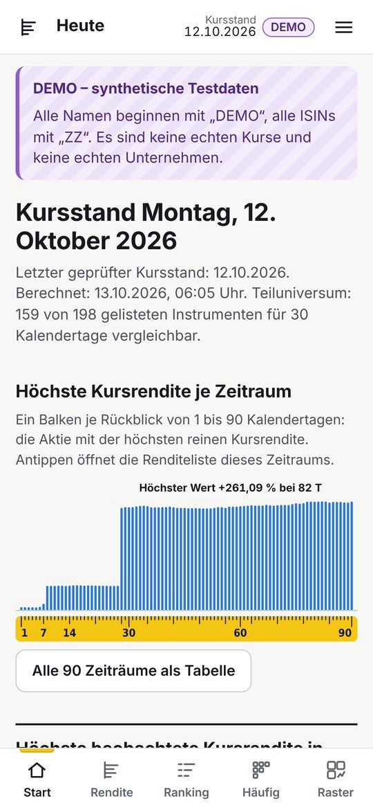
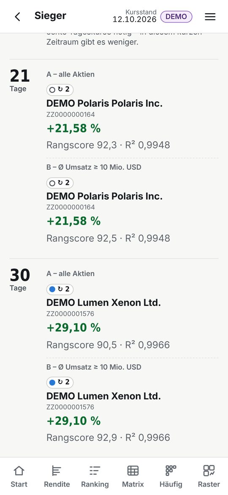
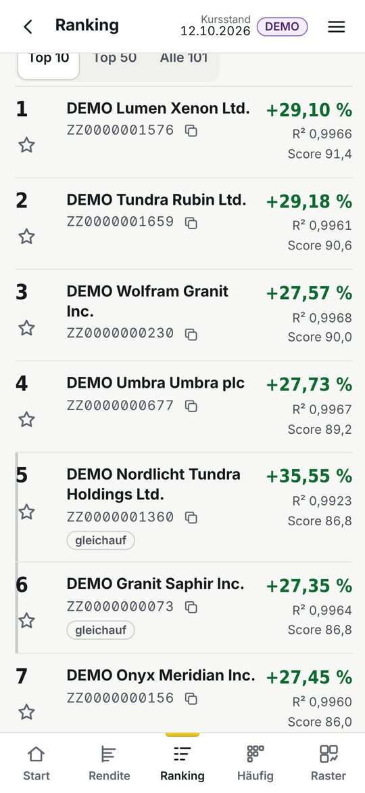
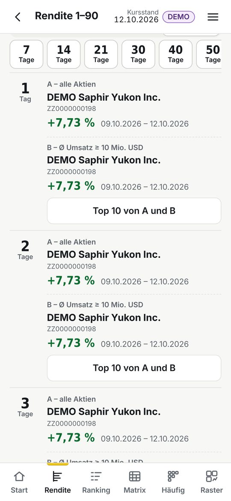
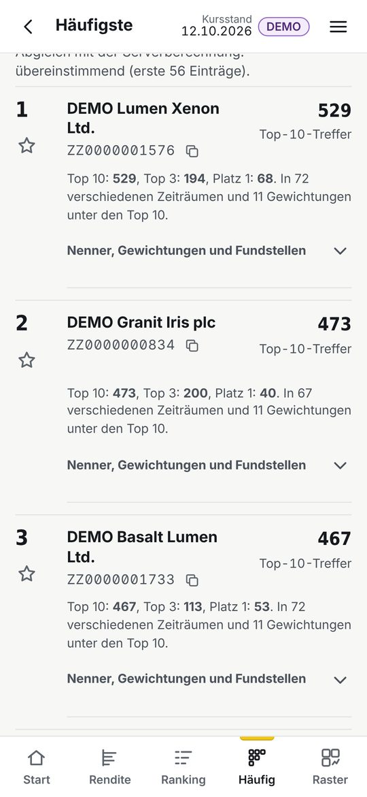
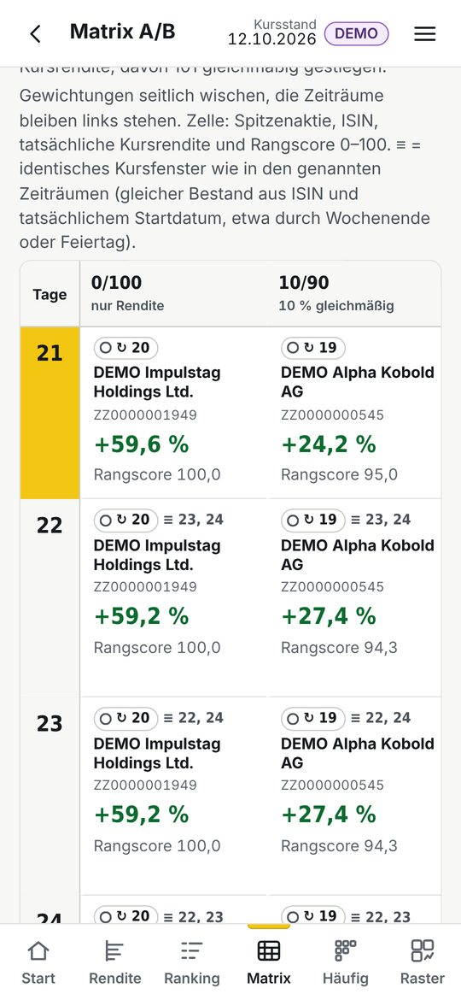
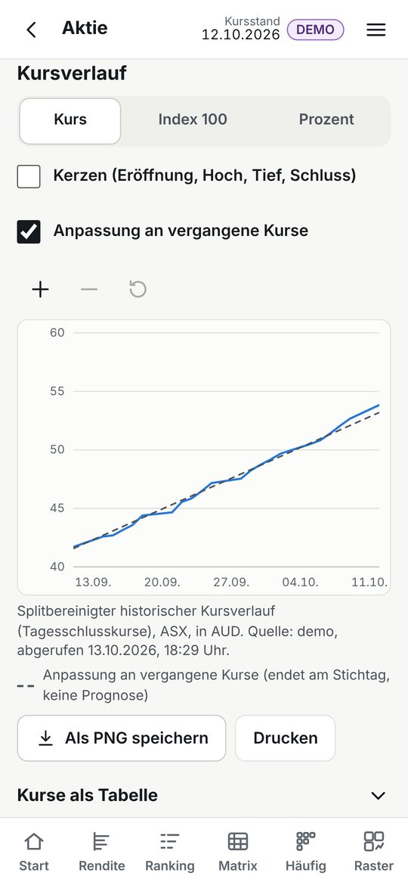
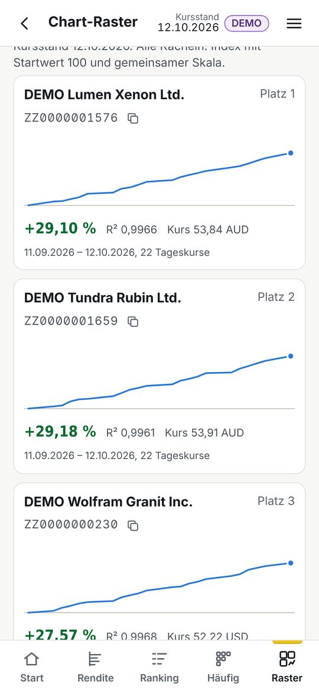

# Kurzanleitung für das Handy

Die App zeigt jeden Morgen neu berechnet, welche Aktien aus der Trade-Republic-Aktienliste in den letzten 1 bis 90 Kalendertagen gestiegen sind – nach reiner Kursrendite und nach „gleichmäßig steigend“. Gerechnet wird auf dem Server. Das Handy muss dafür weder eingeschaltet noch die App geöffnet sein.

## 1. Auf dem Galaxy S25+ installieren

**Chrome**
1. Die Adresse der App öffnen (steht nach der Einrichtung in GitHub unter *Settings → Pages*, Form `https://<name>.github.io/tr-aktienvergleich/`).
2. Oben rechts auf ⋮ tippen.
3. „App installieren“ wählen (bei manchen Versionen „Zum Startbildschirm hinzufügen“ und dann „Installieren“).
4. Bestätigen. Das gelbe Symbol „TR-Vergleich“ liegt danach auf dem Startbildschirm.

**Samsung Internet**
1. Adresse öffnen.
2. Unten rechts auf ≡ tippen.
3. „Seite hinzufügen zu“ → „Startbildschirm“ (oder das Installieren-Symbol in der Adressleiste).
4. „Hinzufügen“.

Die Menünamen können je nach Browserversion leicht abweichen. In der App selbst steht die Anleitung unter ☰ → „Auf dem Startbildschirm installieren“.

## 2. Erster Start: Zugangsschlüssel

Die Daten sind verschlüsselt veröffentlicht. Beim ersten Öffnen einmal die Passphrase eingeben – das geht auch schon, bevor der erste Datenstand veröffentlicht ist (Feld unter „Noch kein Datenstand veröffentlicht“, Knopf „Prüfen und speichern“). Gemeint ist die Passphrase, die bei der Einrichtung als GitHub-Secret `DATA_PASSPHRASE` festgelegt wurde. Das Handy speichert nur einen daraus abgeleiteten, nicht auslesbaren Schlüssel, nicht die Passphrase selbst. Unter ☰ → Einstellungen lässt er sich wieder vergessen.

## 3. Aufbau: fünf Bereiche unten in der Leiste (ab 1.6)

| Bereich | Was er zeigt |
|---|---|
| **Start** | Oben **Kandidaten mit Potenzial**: die fünf Aktien mit den stärksten Signalen – Reiter *Beides stark*, *Kurzfristig*, *Langfristig*, *Kursziel*. Jede Zeile hat zwei Ampeln (**kurz** = Tage bis wenige Wochen, **lang** = etwa 12 Monate), die Punkte bzw. die erwartete Steigerung bis zum Kursziel und bis zu vier Gründe („Kursziel +28 %“, „Umsatz 2,1× üblich“, „8 von 10 Tagen gestiegen“). Darunter die Auswahl für die Rendite-Ranglisten (Gruppe A/B, Zeitraum, Gewichtung) mit den ersten fünf, Einstiege, Sieger nach Zeitraum, Rendite-Leiter. |
| **Rendite** | Oben vier Reiter: **Rendite 1–90** (alle 90 Zeiträume, Sieger der Gruppen A und B), **Bericht 1–30** (ab 1.8.1, siehe unten), **Gleichmäßig + Rendite** (Rangliste nach Gewichtung, früher „Ranking“) und **Sieger** (zehn feste Zeiträume). |
| **Potenzial** | Vollständige Liste der Kandidaten: *Beides stark* (beide Ampeln grün zuerst), *Kurzfristig*, *Langfristig*, *Kursziel* (höchste erwartete Steigerung). „Filter“: mindestens so viele Analysten, Branche, nur grün, nur Gruppe B. |
| **Aktien** | Reiter **Alle Aktien** (Suche, Abdeckung) und **Watchlist**. Die Einzelansicht einer Aktie gehört hierher. |
| **Analyse** | Werkzeuge mit je einem Satz, wofür sie gut sind: Matrix A/B, Häufigste Aktien, Chart-Raster, Gewichtungen vergleichen, Umschichtungs-Regel. |

**Einzelansicht einer Aktie** (Antippen in einer Liste): oben Name, ISIN, Börse, Schlusskurs und die beiden Ampeln; darunter vier Reiter.

* **Überblick:** *Urteil der Signale* (kurz- und langfristig, Punkte 0–100 und ein Satz, warum), *Prognose (12 Monate)* mit erwarteter Steigerung, Kursziel-Spanne und Grafik (Kurs bisher, Ø Kursziel, Spanne, übliche Schwankung), *Trefferquote der Vergangenheit* („Aktien mit ähnlichem Bild stiegen in 5 Handelstagen in 56 % der Fälle …“), *Kursverlauf* mit 1W / 1M / 3M / 6M / 1J / Max, *Signale im Einzelnen* mit Balken und Begründung.
* **Analysten:** Kursziele je Quelle, Kaufen/Halten/Verkaufen heute und in den drei Monaten davor, neueste Urteile der Analystenhäuser (US), Bewertung von Trading Central (US), Nachrichten mit Tendenz (▲ ▼ ●), Stimmung der Community als Balken.
* **Kennzahlen:** Bewertung, Wachstum, Finanzen, Risiko und nächster Zahlentermin – jede Zeile mit Erklärung.
* **Rendite 1–90:** die bisherigen Angaben (Kennzahlen eines Zeitraums, Kursgrafik, Ränge in allen Gewichtungen, Stammdaten).

Überall gilt: **ⓘ antippen** zeigt in einem Satz, was die Zahl bedeutet und wie sie entsteht. Die Ampeln sind eine Zusammenfassung nach festen Regeln – keine Kaufempfehlung. Grün heißt „die meisten Signale sind positiv“, nicht „wird steigen“.

**Bericht 1–30** (Rendite → Bericht 1–30, auf der Startseite der erste Einstieg): der Bericht „1–30 Tage · Rendite und Gleichmäßigkeit“ zum Durchscrollen – täglich mit den neuen Kursen, im Zwischenstand mit den vorläufigen Kursen.

- Oben vier Kennzahlen (ISINs im TR-Verzeichnis, geladene Kursreihen, Aktien in mindestens einem 1–30-Tage-Fenster, Ranglisten mit Spitzenreiter von 240) und **Am häufigsten auf Platz 1** (fünf Aktien, gezählt über alle Ranglisten des Berichts).
- **Spitzenreiter je Zeitraum:** vier Tabellen untereinander (0/100, 40/60, 50/50, 60/40), je Zeile ein Zeitraum von 1 bis 30 Tagen, links Gruppe A (alle Aktien), rechts Gruppe B (Ø Tagesumsatz ab 10 Mio. USD). Jede Zelle: Name, ISIN, Kursrendite, Zeitraum, Währung, bei gemischten Gewichtungen der Score; ↻ 5 = dieselbe Aktie liegt in fünf Zeiträumen dieser Spalte vorne. Kurze Zeiträume ohne 15 Schlusskurse stehen zusammengefasst in einer schraffierten Zeile („1–19 · Nicht berechenbar …“). Oben lässt sich auch nur eine Gewichtung zeigen. Antippen öffnet Kursverlauf und Kennzahlen.
- **Alle vier Gewichtungen nebeneinander:** dieselben Sieger als Matrix für Gruppe A oder B; gleiche Farbe und ↻ = dieselbe Aktie mehrfach vorne.
- **Welche Aktie erscheint am häufigsten?** wie in der Datei mit Filtern (A und B, nur A, nur B; alle vier Gewichtungen oder nur 40/60, 50/50, 60/40; nach ersten Plätzen oder Top-10-Nennungen; gleiche Kursfenster einmal) – Spalten Platz 1, Top 3, Top 10.
- **Kästchen hinter dem Namen** (ab 1.8.2): die Gesamtwertung 0–100 der Aktie (grün ab 65, gelb ab 50, sonst grau) – so siehst du neben dem Rückblick, welche der häufigen Sieger auch nach vorn stark bewertet sind.
- **Hervorheben:** eine Aktie in der Matrix oder in den Häufigkeitslisten antippen → alle ihre Fundstellen auf der Seite sind umrahmt, die Leiste unten nennt die ersten Plätze (A und B); „Nächstes Vorkommen“ springt weiter, „Kursverlauf“ öffnet die Aktie, ✕ hebt die Markierung auf.
- Unten: vollständige Rangliste, Kursverläufe im Raster, Abdeckung, Rechenvorschrift und **Bericht herunterladen (CSV)** mit allen 240 Spitzenreitern.

**Sieger nach Zeitraum** (Rendite → Sieger): zehn Zeilen für 7, 14, 21, 30, 40, 50, 60, 70, 80 und 90 Tage, Gruppe A und B nebeneinander, Gewichtung oben wählbar. Bei 0/100 der tatsächliche Renditesieger, sonst der Sieger nach Rangscore mit seiner tatsächlichen Kursrendite im selben Zeitraum. Antippen zeigt Beginn, Ende, Zahl der Schlusskurse und Referenzmarkt. Bei 7 und 14 Tagen mit Gleichmäßigkeitsanteil steht „Gleichmäßigkeit nicht berechenbar“ (zu wenige Schlusskurse). Darunter eine eigene Zählung nur über diese zehn Zeiträume.

Über ☰ oben rechts: Jetzt aktualisieren, Kandidaten mit Potenzial, Bericht 1–30 Tage, Watchlist, Analyse-Werkzeuge, Datenstand & Betrieb, „So wird gerechnet“, Einstellungen, Installieren.

### Umschichtungs-Regel (Analyse → Umschichtungs-Regel, auch unten auf der Startseite)

Eine feste Rechenregel zum Ausprobieren, keine Anlageberatung: Sie hält gedanklich die 5 (oder 10) Aktien mit der höchsten Kursrendite der letzten 13 (oder 4) Wochen zu gleichen Teilen – nur Aktien mit Ø Tagesumsatz ab 10 Mio. USD – und schichtet am ersten Freitag im Monat (oder jeden Freitag) um, umgesetzt am nächsten Handelstag.

- **Heute nach der Regel:** das gelbe Depot-Lineal zeigt die Aufteilung des Regeldepots (Nummer = Zeile in der Liste darunter, schraffiert = Bargeld). Darunter steht, was die Regel ändern würde – zum Beispiel „Verkaufen: …, Anteil 21 % → 0 %“ und „Kaufen: …, 0 % → 20 %, etwa 4.360 €“ – jeweils mit Grund. Nach einem Umschichtungstag heißt es „Was die Regel jetzt umsetzt“.
- **Beträge umrechnen:** eigenen Depotwert eintragen (z. B. 12.500) → alle Beträge auf diesen Wert umgerechnet, gleiche Anteile. Gespeichert nur auf diesem Handy.
- **Rückblick:** Wertverlauf des Regeldepots nach Kosten und Steuern im Vergleich zur selben Regel ohne Kosten und zu „alle Kandidaten zu gleichen Teilen“, darunter Endwert, größter Rückgang, Orders und Steuern, alle Umschichtungen mit Orders und die heutige Rangfolge.
- **Varianten:** oben Anzahl Aktien, Rhythmus, Trendzeitraum und Startkapital wählen; die Tabelle „Alle Varianten“ vergleicht sie im selben Zeitraum.

Das Regeldepot ist gedacht – die App kennt dein echtes Depot nicht und handelt nie. Der Rückblick kennt nur heute noch gelistete Aktien und ist deshalb eher zu gut.

## 4. Gewichtung lesen

Die erste Zahl ist immer der Anteil **Gleichmäßigkeit**, die zweite der Anteil **Kursrendite**:

- **Nur Kursrendite (0/100):** reine Prozentrangliste, auch schwankende Verläufe und Verluste.
- **50/50**, **60/40**: deine Mischungen – auf der Startseite und unter „Sieger nach Zeitraum“ direkt antippbar, im Ranking als Schnelltasten unter dem Schieberegler.
- **Nur Gleichmäßigkeit (100/0):** am geradesten gestiegene Aktien.

Alle elf Stufen (0, 10, 20 … 100) sind über den Schieberegler erreichbar. Mit Gleichmäßigkeitsanteil zählen nur Aktien, die im Zeitraum mindestens 15 echte Tageskurse haben und gestiegen sind (positive Rendite und positive Trendsteigung). In kurzen Zeiträumen unter etwa drei Wochen bleibt diese Liste deshalb leer; die App nennt dann den Grund und bietet die reine Renditeliste an.

## 5. Zahlen verstehen

- **Kursrendite:** Veränderung vom Startkurs bis zum Kursstand, in der Börsenwährung, ohne Dividenden und ohne Euro-Umrechnung. Immer mit Vorzeichen und Text, nicht nur farbig.
- **R²** (zum Beispiel 0,9326): wie nah die Kurse an einer geraden Linie liegen. 1 wäre exakt gerade. Sagt nichts über Sicherheit oder die Zukunft.
- **Rangscore 0–100:** Mischung aus dem Platz bei der Gleichmäßigkeit und dem Platz bei der Rendite, nur innerhalb der verglichenen Aktien. Keine Prognose und keine Wahrscheinlichkeit.
- **30 Tage** heißt immer 30 Kalendertage zurück, nicht „ein Monat“ und nicht 30 Börsentage.
- **Stand / Kursstand:** der Börsentag, dessen Schlusskurse verwendet wurden. Steht oben rechts in jeder Ansicht.

## 6. Jetzt aktualisieren, unterwegs und offline

**Jederzeit aktualisieren:** ☰ → **Jetzt aktualisieren** (auch unter Datenstand & Betrieb und, solange noch kein Stand da ist, auf der Startseite).

1. „Lauf auf GitHub starten“ antippen – GitHub öffnet „Täglicher Lauf“ (falls nötig anmelden).
2. „Run workflow“ antippen. **Während des Handelstags:** Haken bei **„Zwischenstand“** – alle Ranglisten mit den Kursen von jetzt (vorläufig, etwa 15–20 Minuten verzögert; dauert etwa 10–15 Minuten). **Für neue Schlusskurse:** Felder leer lassen. Dann den grünen Knopf „Run workflow“ bestätigen.
3. Zurück in die App. Sie schaut jede Minute nach und meldet „Zwischenstand fertig“ bzw. „Aktualisierung fertig“ – oder „Lauf beendet – keine neuen Kurse“ mit Grund.

**Zwischenstand lesen:** Oben steht „Zwischenstand 13.10. 12:15“ statt „Kursstand“, darunter ein Hinweis, welche Börsen noch keinen Kurs von heute haben (z. B. USA vor 15:30 Uhr – deren Aktien fehlen dann in den Ranglisten). „Offiziellen Stand anzeigen“ wechselt zu den Schlusskursen, „Zwischenstand anzeigen“ zurück. Am nächsten Morgen ersetzt der tägliche Lauf den Zwischenstand.

Neue Schlusskurse gibt es einmal je Börsentag, frühestens etwa eine Stunde nach Handelsschluss in New York (meist gegen 23 Uhr). Die Seite nennt den genauen Zeitpunkt („Neue Schlusskurse für Dienstag … gibt es heute ab 23:00 Uhr“). Ein Lauf vorher bringt keinen neuen Kursstand, übernimmt aber nachgelieferte Kurse. Gestartet wird über GitHub, weil die App absichtlich keinen Zugangsschlüssel enthält. Läuft schon ein Lauf, wartet ein zweiter Start, bis der erste fertig ist.

**Offline:** Einmal geladene Ansichten bleiben ohne Netz lesbar; die App sagt dann „Offline – gespeicherter Stand“ und nennt das Datum. Kommt ein neuer Datenstand, erscheint „Neuer Datenstand verfügbar“ – die aktuelle Liste bleibt, bis du wechselst.

## 7. Watchlist

Stern antippen merkt eine Aktie. Die Watchlist zeigt den Platz in der gesamten Rangliste und auf Wunsch eine Rangfolge nur innerhalb der Watchlist (deutlich als Untergruppe gekennzeichnet). **ISINs importieren und exportieren:** ISINs einfügen (eine je Zeile oder mit Komma) → „In die Watchlist übernehmen“; doppelte werden zusammengeführt, ungültige (falsche Prüfziffer) genannt, Namen oder Ticker nie zugeordnet. „ISIN-Liste exportieren“ bzw. „Mit Namen als CSV“ sichern die Liste. Sie liegt nur auf diesem Handy (Sicherung auch unter ☰ → Einstellungen → „Als Datei sichern“) und hat nichts mit der Watchlist oder dem Depot bei Trade Republic zu tun.

## 8. Was die App nicht tut

Keine Anlageberatung und keine Prognose (die Umschichtungs-Regel zeigt nur, was eine feste Rechenregel täte), keine Live-Kurse in Echtzeit (Tagesschlusskurse; auf Wunsch ein Zwischenstand mit verzögerten Kursen), keine Orders, kein Zugriff auf ein Depot, keine Anmeldung bei Trade Republic. Dass eine Aktie in der TR-Liste steht, heißt nicht, dass sie im eigenen Konto jederzeit handelbar ist.

## 9. Nach der Installation kurz prüfen (5 Minuten)

Diese Prüfung auf dem echten Gerät steht noch aus (09_Bekannte_Luecken). Bitte einmal durchgehen und Auffälliges notieren:

1. App vom Startbildschirm öffnen: Sie startet ohne Browserleiste, oben steht „Kursstand“ mit Datum – und **kein** DEMO-Hinweis.
2. Passphrase eingeben, App schließen und wieder öffnen: Sie bleibt entsperrt.
3. **Rendite**: 90 Zeilen, jede mit vollem Namen, ISIN und Prozentwert; eine ISIN antippen und kopieren.
4. **Ranking**: die Tasten 7, 30 und 90 Tage antippen, im Feld „Freier Zeitraum“ 37 eingeben, Gewichtung 60/40 und 50/50 wählen; eine Aktie öffnen.
5. Im Kurschart mit einem Finger über den Verlauf streichen (Tageskurs erscheint) und mit zwei Fingern zoomen; mit der Zurück-Geste zur Liste zurück.
6. **Raster**: „Mehrere Zeiträume“ und „Gemeinsam“ antippen. ☰ → **Sieger nach Zeitraum**: zehn Zeilen, Gewichtung 50/50 wählen, eine Zelle antippen.
7. Flugmodus einschalten, App öffnen: „Offline – gespeicherter Stand“ mit Datum.
8. ☰ → Datenstand & Betrieb: letzter Lauf, Uhrzeit 07:00 und Abdeckung sind angegeben.

## So sieht es aus

Bildschirmfotos aus dem automatischen Browser-Test (S25+-Bildschirmgröße in Chromium, **DEMO-Daten** mit erfundenen Firmen – keine echten Kurse; Version 1.5.0):

| Start: Auswahl | Sieger nach Zeitraum (50/50) | Ranking 30 Tage, 60/40 |
|---|---|---|
|  |  |  |

| Rendite 1–90: A und B | Häufigste Aktien | Matrix A/B |
|---|---|---|
|  |  |  |

| Kurschart | Chart-Raster |
|---|---|
|  |  |
